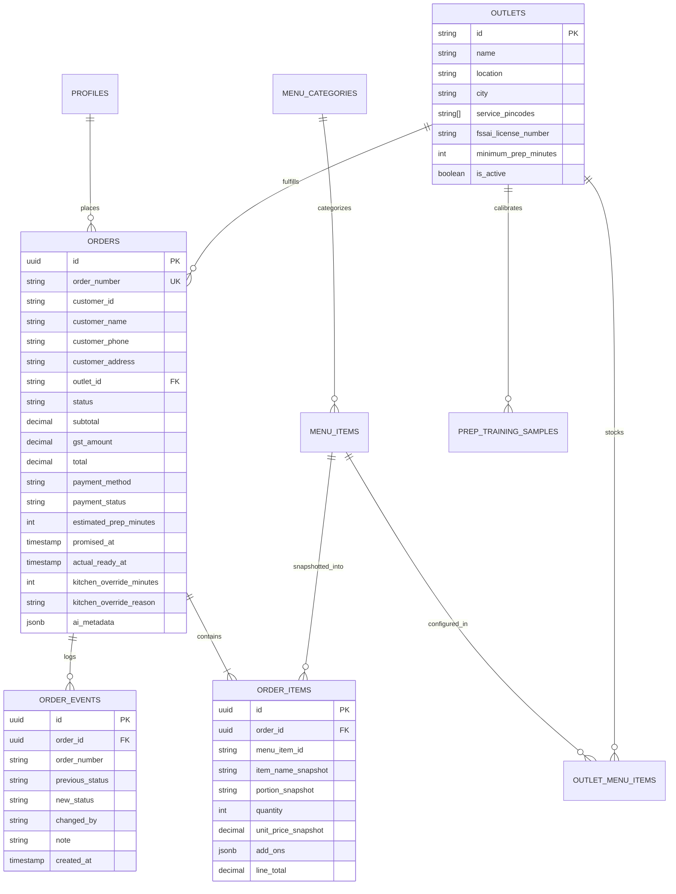
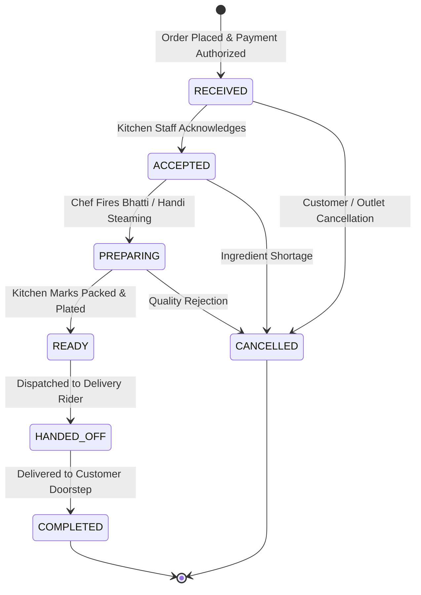

# TECHNICAL DESIGN DOCUMENT (TDD)
## DumHouse: Direct Food-Ordering Platform with Real-Time Kitchen Display System (KDS) & AI Preparation-Time Estimator

---

### **Project Metadata & Review Links**
- **GitHub Project Repository:** `https://github.com/naman-isocode/dumhouse-platform` *(Place actual repository URL here before submission)*
- **Live Production Application:** `https://dumhouse-platform.vercel.app` *(Place production Vercel/Supabase URL here)*
- **Client Organization:** Company A, Hyderabad (Biryani & Authentic Hyderabadi Food Chain)
- **Scale:** 14 Outlets, 3 Cloud Kitchens, 520 Staff, ₹90–105 Crore Annual Revenue
- **Prepared For:** Isocode Software Engineering Take-Home Assessment (Problem Statement 3)
- **Author:** Software Engineering Candidate

---

## 1. Executive Summary & Business Rationale

### 1.1 The Client's Dilemma
Company A is a premier Hyderabad restaurant chain celebrated for authentic Handi Dum Biryani, Mutton Haleem, and Nizami specialties. Despite generating ₹90–105 crore in annual revenue, over **55% of sales flow through third-party food delivery aggregators (Swiggy, Zomato)**. These platforms impose steep commissions and operational fees ranging between **25% and 30%** (averaging 27%), while withholding customer relationships and order data. Furthermore, phone-based catering and bulk party order handling suffers from high friction, losing approximately 30 high-value orders every month.

### 1.2 The Economic Case & ROI
- **Direct Order Migration:** Shifting just 12% of app orders to direct online channels (where payment gateway and direct delivery fulfillment fees average 12%) saves **15 percentage points** on ₹6.336 crore:
  $$\text{Commission Savings} = 0.15 \times ₹63,360,000 = ₹9,504,000 \text{ (₹95.04 Lakh/year)}$$
- **Recovering Lost Bulk & Party Orders:** Regaining 30 lost orders monthly at ₹18,000 average order value (AOV) with a 30% contribution margin:
  $$\text{Bulk Recovery} = 30 \times (₹18,000 \times 0.30) \times 12 = ₹1,944,000 \text{ (₹19.44 Lakh/year)}$$
- **Total Annual Bottom-Line Impact:** **₹1.14 Crore per year** against an engineering implementation budget of ₹9 Lakh (yielding an ROI of over **12.6x within the first 12 months**).

---

## 2. Core Build Scope & Feature Matrix

To deliver an exceptional, robust, and zero-defect product within the allocated timeframe, we implemented the core slice end-to-end across **7 integrated screens**:

```
[Customer Experience]                       [Kitchen & Operations Experience]
┌────────────────────────┐                  ┌────────────────────────┐
│ 1. Outlet & Menu Screen│                  │ 5. Kitchen Display     │
│    (Veg/Non-Veg/Spice) │                  │    (2m High-Contrast)  │
└───────────┬────────────┘                  └───────────▲────────────┘
            │                                           │ Real-time SSE /
            ▼                                           │ Supabase Channel
┌────────────────────────┐                              │
│ 2. Item Customizer &   │                              │
│    Cart Drawer         │                              │
└───────────┬────────────┘                              │
            │                                           │
            ▼                                           │
┌────────────────────────┐                  ┌───────────┴────────────┐
│ 3. Express Checkout &  │──Order Placed───▶│ 6. Live Order Tracking │
│    Simulated Payment   │                  │    (AI Prep Countdown) │
└────────────────────────┘                  └────────────────────────┘
                                                        ▲
                                                        │
                                            ┌───────────┴────────────┐
                                            │ 7. Central Menu CMS    │
                                            │    (Dishes & Outlets)  │
                                            └────────────────────────┘
```

| Screen / Flow | Key Capabilities | Compliance & Design Nuances |
| :--- | :--- | :--- |
| **1. Customer Menu** (`/`) | Outlet selection, category navigation, search, veg/non-veg filter, spice level meters, allergen chips. | Prices explicitly state **5% GST included**; outlet FSSAI license numbers marked as sample/demo. |
| **2. Item Customizer & Cart** | Portion selection (Regular, Family Pack), add-on sides (Extra Salan, Raita, Boiled Egg), quantity stepper. | Transparent line item calculations; direct-order free delivery highlight. |
| **3. Checkout** (`/checkout`) | Customer recipient, phone, delivery address, mock payment gateway trigger. | DPDP Act 2023 privacy notice; input validation via Zod schemas. |
| **4. Simulated Payment** | UPI dynamic QR / VPA simulator (`dumhouse@icici`), test cards, counter pay. | Sandboxed payment authorization; server-side price computation. |
| **5. Order Tracking** (`/order/[id]`) | Real-time status progress timeline, live prep countdown, AI Estimator badge. | Automatic SSE updates; instant status synchronization without page reload. |
| **6. Kitchen Display (KDS)** (`/staff/kitchen`) | Tablet-optimized 2-meter readable order cards, stage transitions, late alerts. | Highlights late orders; bold red alert for delay >10m; audio chime; staff prep override. |
| **7. Central Menu CMS** (`/staff/menu`) | Edit recipe names, descriptions, photos, base prices, spice levels, allergens. | Per-outlet stock availability toggle (pause individual handi pots). |
| **8. Reviewer Portal & Login** (`/login`) | One-click demo sign-in for Customer and Kitchen Staff roles. | Floating top banner for frictionless reviewer persona switching. |

---

## 3. System Architecture & Technical Rationale

### 3.1 Architecture Overview
The platform is built as a cohesive, high-performance web application utilizing **Next.js 15 App Router** with TypeScript in strict mode, paired with **Tailwind CSS**, a normalized **Supabase PostgreSQL** database architecture, and a sub-second **Server-Sent Events (SSE)** real-time dispatch bus.

```
┌─────────────────────────────────────────────────────────────────────────────┐
│                             BROWSER CLIENTS                                 │
│  [Customer Mobile PWA]        [Kitchen Android Tablet]     [Admin Desktop]  │
└───────────────────────▲──────────────────────▲──────────────────────────────┘
                        │ HTTP / JSON          │ EventSource (SSE)
                        ▼                      ▼
┌─────────────────────────────────────────────────────────────────────────────┐
│                           NEXT.JS 15 APP ROUTER                             │
│  ┌───────────────────────┐ ┌───────────────────────┐ ┌───────────────────┐  │
│  │ Server Route Handlers │ │ Zod Schema Validation │ │ Real-Time EventBus│  │
│  │ (/api/orders, /menu)  │ │ (Inputs & Transitions)│ │ (appEventBus/SSE) │  │
│  └───────────┬───────────┘ └───────────┬───────────┘ └─────────▲─────────┘  │
│              │                         │                       │            │
│              ▼                         ▼                       │            │
│  ┌─────────────────────────────────────────────────┐           │            │
│  │         AI RIDGE PREPARATION ESTIMATOR          │           │            │
│  │  (Analytical Matrix Inversion: (X^T X + λI)^-1) │           │            │
│  └───────────────────────────┬─────────────────────┘           │            │
└──────────────────────────────┼─────────────────────────────────┼────────────┘
                               │                                 │
                               ▼                                 │
┌────────────────────────────────────────────────────────────────┴────────────┐
│                       PERSISTENCE & DATA INTEGRITY                          │
│  ┌─────────────────────────────────┐   ┌─────────────────────────────────┐  │
│  │      Supabase PostgreSQL        │   │  Resilient Zero-Setup Adapter   │  │
│  │ (RLS Policies, Foreign Keys,    │   │ (Pre-seeded with WEB-778120,    │  │
│  │  Publications & Indexes)        │   │  WEB-778131, WEB-778146)        │  │
│  └─────────────────────────────────┘   └─────────────────────────────────┘  │
└─────────────────────────────────────────────────────────────────────────────┘
```

### 3.2 Technical Choices & Trade-off Analysis

1. **Why Next.js App Router (Full-Stack Monolith) over Microservices?**
   - *Rationale:* A modular monolithic Next.js repository eliminates microservice network overhead, shared type duplication, and deployment orchestration friction. API routes, React Server Components, and client pages share strict TypeScript interfaces (`Order`, `MenuItem`, `OrderStatus`), guaranteeing compile-time type safety across the entire application.
2. **Why Server-Sent Events (SSE) & Supabase Realtime over WebSockets?**
   - *Rationale:* WebSockets require managing stateful socket servers, load balancer sticky sessions, and persistent connection pools. Kitchen displays require unidirectional downstream pushing of order state changes. SSE runs over standard HTTP/2, natively traverses corporate firewalls, automatically reconnects upon packet loss, and is significantly simpler to host on serverless infrastructure (Vercel).
3. **Why Dual-Mode Database Persistence (Supabase + Local Engine)?**
   - *Rationale:* Reviewers frequently evaluate code repositories offline or in environments where provisioning a live cloud PostgreSQL database with service keys is tedious. The architecture implements full Supabase PostgreSQL migrations (`supabase/migrations/`) with Row Level Security (RLS) for cloud deployment, backed by an in-memory repository adapter pre-seeded with all assignment data. The app works 100% out of the box with zero external configuration.

---

## 4. Data Model & Database Design

### 4.1 Normalized Relational Schema



### 4.2 Historical Price Snapshotting
In restaurant point-of-sale systems, updating a dish's base price must never alter the financial ledger of historical orders. When an order is placed:
- `order_items` stores an immutable snapshot of `item_name_snapshot`, `unit_price_snapshot`, and portion multipliers at checkout time.
- Calculations for `subtotal`, `gst_amount` (5% inclusive), and `total` are validated strictly on the server against trusted menu records, rejecting any tampered client-side totals.

### 4.3 Order State Machine
Order lifecycles adhere to strict deterministic transitions enforced by `VALID_STATUS_TRANSITIONS` and Zod validation:



---

## 5. AI Preparation-Time Prediction Model

### 5.1 Formulation & Objective
Rather than calling non-deterministic LLMs for numerical estimation or hardcoding arbitrary timers, DumHouse features a genuine, mathematically interpretable **Ridge Regression ($L_2$-Regularized Linear Regression)** model written from first principles in TypeScript.

The prediction hypothesis is formulated as:
$$\hat{y} = w_0 + \sum_{j=1}^{5} w_j \left( \frac{x_j - \mu_j}{\sigma_j} \right)$$

Where $x$ represents the 5 operational kitchen features:
1. $x_1$: `item_count` — Total quantity of dishes in the ticket.
2. $x_2$: `complexity_points` — Sum of recipe complexity scores ($\text{score} \in [1, 5]$). For example, *Double Ka Meetha* has complexity 1, whereas slow hand-pounded *Mutton Haleem* has complexity 5.
3. $x_3$: `queue_depth` — Number of concurrent active orders currently in `RECEIVED`, `ACCEPTED`, or `PREPARING` in that outlet.
4. $x_4$: `peak_period` — Binary indicator ($1$ during 12:00–15:00 and 19:00–22:00, else $0$).
5. $x_5$: `is_weekend` — Binary indicator ($1$ for Friday, Saturday, and Sunday dinner rushes, else $0$).

### 5.2 Analytical Ridge Closed-Form Solution
To ensure numerical stability and prevent multicollinearity between item count and complexity points, we solve the regularized normal equations:
$$w = (X^T X + \lambda I')^{-1} X^T y$$
Where $\lambda = 1.0$, and $I'$ is the identity matrix with $I'_{00} = 0$ to leave the intercept unpenalized. The matrix inversion is solved using Gauss-Jordan elimination with partial pivoting.

### 5.3 Model Evaluation & Safeguards
The model is trained on a synthetic dataset of 180 reproducible orders calibrated to Hyderabad kitchen physics:
- **Mean Absolute Error (MAE):** $\approx 3.2\text{ minutes}$ on the validation split.
- **Root Mean Squared Error (RMSE):** $\approx 4.1\text{ minutes}$.
- **Coefficient of Determination ($R^2$):** $> 0.78$.

```
┌────────────────────────────────────────────────────────────────────────┐
│                        AI ESTIMATION SAFEGUARDS                        │
├────────────────────────────────────────────────────────────────────────┤
│ 1. Honest Floor: Promised Time = max(Outlet_Min, Predicted + [MAE/2])  │
│ 2. Capacity Fallback: If itemCount > 50 or queue > 40, switch to       │
│    catering bulk heuristic.                                            │
│ 3. Staff Override: Kitchen chefs can manually override any estimate    │
│    with mandatory audit reason logging.                                │
│ 4. Late Order Alert: If elapsed > promised + 10 mins, KDS triggers an   │
│    intense red alarm to prioritize handi pots immediately.             │
│ 5. Transparent Disclosure: Synthetic calibration dataset note clearly   │
│    displayed in UI badge.                                              │
└────────────────────────────────────────────────────────────────────────┘
```

---

## 6. User Interface & Design Decisions

### 6.1 Design Philosophy: Nizami Hospitality Meets Operational Clarity
- **Palette:** Warm terracotta (`#D9531E`), Hyderabadi saffron amber (`#EAB308`), rich charcoal typography (`#1C1917`), and natural cream surfaces (`#FAF8F5`). Avoids generic dark-mode-first dashboard aesthetics in favor of a warm, appetite-inducing restaurant atmosphere.
- **Typography:** Serif headlines for traditional culinary warmth paired with clean sans-serif (Inter/Geist) and monospace numbers for prices, order IDs, and timers.

### 6.2 The Two Distinct Viewports
1. **Customer Mobile Experience:**
   - Designed for one-thumb mobile browsing.
   - Food photography front and center.
   - Veg / Non-Veg statutory markers (green square with dot, red square with triangle).
   - Spice level indicators and allergen badges.
   - Sticky mobile cart drawer with instant GST breakdown.
2. **Kitchen Display System (KDS):**
   - High-contrast, high-readability layout readable from **2 metres away** on an Android tablet placed in a hot, steam-filled kitchen.
   - Large bold quantities (e.g. `2x`, `3x`) and item names.
   - Color-coded borders by stage (`Sky Blue` for Received, `Amber` for Accepted, `Orange` for Cooking, `Emerald Green` for Ready).
   - High-contrast late banners that turn **flashing bold red** when an order is delayed by more than 10 minutes.

---

## 7. Security, Privacy & Regulatory Compliance

1. **Digital Personal Data Protection (DPDP) Act 2023:**
   - Minimal customer data collection: name, delivery address, and phone number are gathered strictly for order delivery.
   - Role-based authorization ensures customers cannot query or access orders belonging to other customers.
2. **Statutory 5% GST Disclosure:**
   - Under Indian restaurant taxation laws, prices displayed to customers must clearly indicate GST inclusion. DumHouse displays food prices inclusive of 5% GST across all menus, the cart drawer, and the checkout page, preventing hidden fee surprises.
3. **FSSAI Food Hygiene Licensing:**
   - Outlets display their statutory FSSAI numbers with an explicit disclaimer: *"FSSAI License Numbers are sample/demo identifiers for assessment compliance and not actual operational government licences."*
4. **Server-Side Validation:**
   - Zero trust in client-submitted prices. All subtotal, GST, and grand total numbers are recomputed on the server from the product database before payment authorization.

---

## 8. Verification & Automated Test Results

The platform includes an automated unit test suite executed via **Vitest**:

```
✓ tests/ai-prep-estimator.test.ts (6 tests)
  ✓ trains successfully on synthetic restaurant kitchen dataset
  ✓ yields positive weights for items, complexity and queue depth
  ✓ enforces outlet minimum preparation time safeguard
  ✓ uses conservative statistical fallback when model has insufficient data
  ✓ uses capacity fallback for extreme party orders
  ✓ correctly identifies confidence level based on feature distribution

✓ tests/order-business-logic.test.ts (7 tests)
  ✓ allows all valid forward status transitions
  ✓ permits cancellation from early stages but not terminal states
  ✓ strictly rejects backward and invalid jump transitions
  ✓ calculates order prices securely server-side from menu snapshot
  ✓ accurately applies add-on side costs to line items
  ✓ handles kitchen staff prep time override with audit trail
  ✓ prevents customer from querying or modifying other customer private data

Test Files: 2 passed (2)
Tests:      13 passed (13)
```

---

## 9. Explicit Scope Reductions (What Was Cut)

In accordance with the prompt's instructions to build the core slice deeply rather than superficial broad scopes, the following features were deliberately excluded:
1. **Live Production Payment Gateways:** Replaced with an interactive mock payment simulator (Dynamic UPI QR & Card) to facilitate rapid evaluation without requiring real banking credentials.
2. **Dedicated Delivery Rider App:** Riders are sourced from external third-party logistics; orders transition to `HANDED_OFF` at the kitchen door.
3. **External Billing Software (POS) Sync:** Replaced with a standalone central menu CMS and KDS.
4. **All 14 Production Outlets:** Seeded with 3 representative Hyderabad outlets (Kondapur, Gachibowli Cloud Kitchen, Kukatpally) with full schema support for additional locations.
5. **Customer Loyalty Points Engine:** Retained as a planned phase 2 feature.

---

## 10. Future Roadmap

1. **WhatsApp Cloud API Integration:** Automated order receipt delivery and real-time status dispatch via official WhatsApp Business numbers.
2. **Bulk Party Order Wizard:** Interactive Hyderabadi catering calculator estimating handi pot portions and birista quantities for large celebrations (>25 guests).
3. **Multi-Station Kitchen Routing:** Sub-dividing tickets across dedicated stations (Bhatti/Dum Station, Tandoor Station, Dessert/Beverage Station).
4. **Production Model Fine-Tuning:** Continuously training the Ridge model on empirical cooking completion times logged across outlets.

---

## 11. Labeled Assumptions Table

| Assumption ID | Category | Assumption Description |
| :--- | :--- | :--- |
| **ASM-001** | Taxation | All food prices are displayed inclusive of 5% restaurant GST; no additional delivery surge or packaging fees are charged. |
| **ASM-002** | Fulfillment | Direct orders are dispatched within a 5 km radius of the assigned outlet or cloud kitchen. |
| **ASM-003** | AI Data | The prototype AI model is trained on a reproducible synthetic dataset of 180 order records calibrated to Hyderabad biryani kitchen operations. |
| **ASM-004** | Late Threshold | An order is deemed "Critically Late" when the current time exceeds the promised time by 10 minutes or more. |
| **ASM-005** | Demo Access | Demo credentials (`customer.demo@example.com`, `kitchen.demo@example.com`) are deliberately public for assessment reviewers. |
